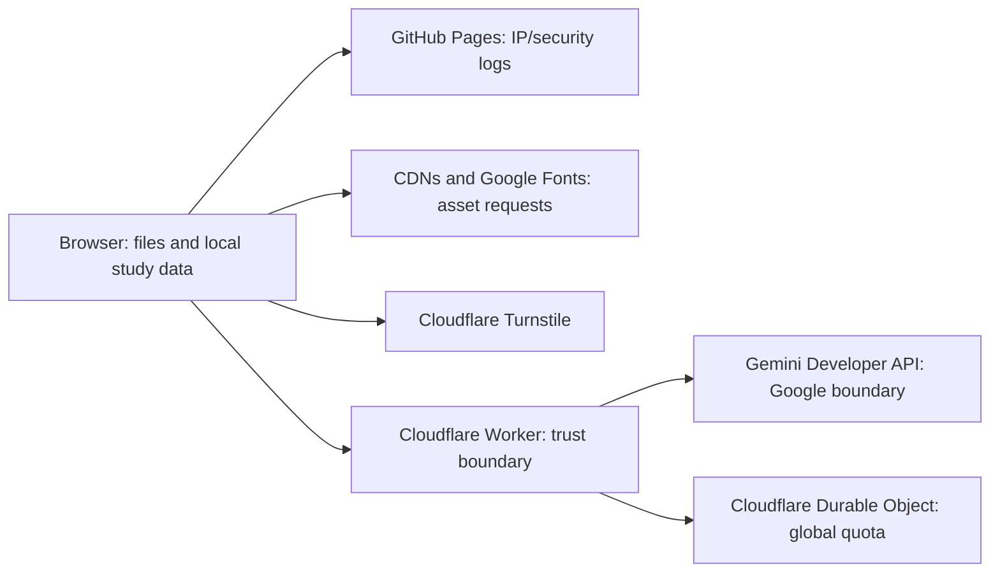

# REM-02 — Data Flow Map

Review date: 29 October 2026. Source: a2c626ac41ba334933ef31043c2f8c8513f39865 (GitHub main). Candidate only; not deployed. Independent reviewer: Pending.

Candidate blocks AI by default. After authorised enablement, acknowledged document requests follow this flow. Website imports rejected. Worker source presence does not prove deployed revision/configuration.
